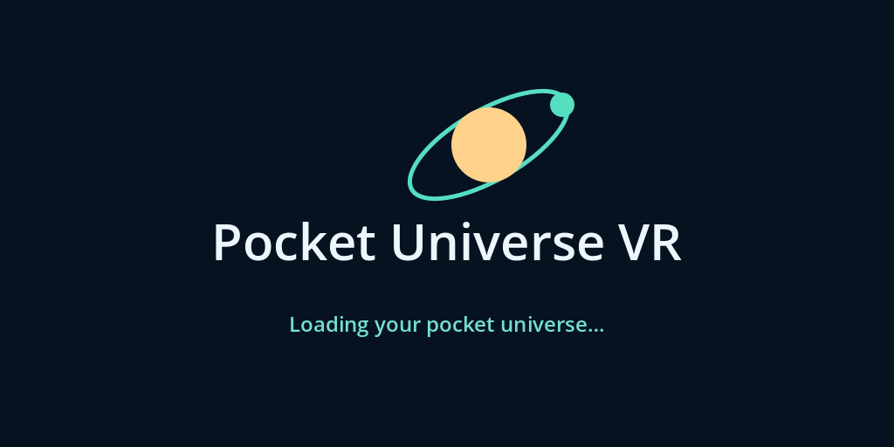

# Pocket Universe VR

A seated, hands-first miniature solar system for Meta Quest, built with Godot 4 and OpenXR for the Meta VR Start Developer Competition 2026.



## Download for Meta Quest

[Download the release APK — v0.6.7](https://github.com/GianmarioJamie/PocketUniverseVR/releases/download/v0.6.7/pocket-universe-release-v0.6.7.apk)

The [GitHub Release](https://github.com/GianmarioJamie/PocketUniverseVR/releases/tag/v0.6.7) also includes the SHA-256 checksum. Install the APK using SideQuest or ADB. If a debug build is already installed, uninstall it first because its signing certificate differs; uninstalling removes local app data.

## Explore with your hands

- Select the Sun or any of the eight planets to see a preview, astronomical facts and a short description.
- Grab or pinch planets to inspect them; release them to return them to their animated orbits.
- Hold Earth to reveal illustrative models of the Moon, ISS and Hubble.
- Grab the Sun to reposition the solar system; use buttons to zoom, pause or change orbital animation speed.
- Move the information card by grabbing its free surface, or use its attached + / − buttons to change its distance.
- Follow **Three Wonders**, an optional three-stop journey with stars and original chimes, or explore freely.
- Use Reset scene, Recenter view and Exit from the card.

Planet diameters are proportional. The Sun, orbital spacing and animation times are adapted for comfortable viewing. Surfaces and spacecraft are original illustrations, not photographic or engineering reproductions.

## Current version and validation

Version **0.6.7**, Android versionCode **15**, package `com.jamiejoe.pocketuniverse`.

The entrant reports the release APK working on a physical Quest 2. A separate short measurement of the same version's **debug build** collected 182 per-application VrApi samples over approximately three minutes: **71–72 FPS at 72 Hz**, mean 71.995, with no sample below 60. Runtime compositor counters were nonzero; see the [performance report](docs/PERFORMANCE_QUEST2.md) for the data interpretation and limits. This is not a full VRC certification or a measurement of the release APK.

The Android manifest declares Quest 2, Quest 3, Quest 3S and Quest Pro. Quest 3 and Pro have simulator evidence; physical Quest 3/3S/Pro compatibility has not been validated. The Mac simulator runs the native OpenXR project rather than emulating the Android APK.

## Run a desktop preview

The development setup used **Godot 4.7.2** and **Godot OpenXR Vendors 5.2.0**. The Vendors add-on is included with its third-party notices; Godot itself is not bundled.

Open `project.godot` with Godot, or run this command from the repository directory using your Godot executable:

```sh
godot --path . --xr-mode off --rendering-method gl_compatibility -- --desktop
```

The desktop preview uses mouse input and does not establish headset compatibility. See [testing instructions](docs/TESTING_INSTRUCTIONS.md) for the VR controls.

## Build for Quest

Install matching Godot Android export templates, a JDK and the Android SDK, configure their paths in Godot, and install the Android build template. The `Meta Quest` export preset targets ARM64, minimum SDK 29 and target SDK 34. Enable hand tracking on the headset.

The scripts in `scripts/` document the original macOS development setup, which expects tools under `tools/` and downloaded templates under `downloads/`. Those directories are intentionally excluded. Some preparation scripts wait for pre-downloaded files; configure the prerequisites before running them. See [Android notes](docs/ANDROID.md).

Release exports require your own private signing configuration. Signing keys and credentials are never included in this repository. Debug and release builds use different certificates; changing between them on a headset requires uninstalling the existing app, which removes local app data.

## Repository contents

- `src/`, `scenes/`, `data/`: experience logic, scenes and astronomical data.
- `assets/`: original illustrations, procedural shader, input action map and notices.
- `addons/godotopenxrvendors/`: XR vendor add-on and libraries.
- `scripts/`: development launchers, export helpers and regression checks.
- `docs/`: testing, sources, privacy policy, submission copy and validation history.

Generated builds, downloaded SDKs, engine binaries, caches, device logs, private backups and signing material are excluded. The competition APK is distributed separately through the Meta Competition release channel, not through a source checkout.

## Privacy and attribution

The experience runs locally, without accounts, analytics, advertising, purchases or network permission. Headset and hand tracking are processed locally for interaction. See the [privacy policy](docs/PRIVACY_POLICY.md); [standalone HTML](docs/privacy-policy.html) is also available for hosting.

Astronomical references and original-model provenance: [planet data](docs/PLANET_SOURCES.md), [Earth companions](docs/EARTH_COMPANIONS.md), [previews](docs/PREVIEWS.md). Godot, OpenXR Vendors and Meta component notices are in `assets/licenses/` and the add-on directories. The CC0 dedication documented for Earth companion geometry applies only to those original contributions; third-party components retain their own terms. Godot licensing information: https://godotengine.org/license/.
